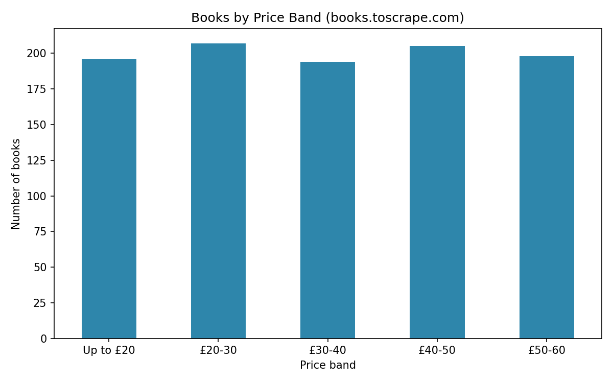

# Book Data Scraper

A Python scraper that collects 1,000 books across 50 pages from
books.toscrape.com (a practice site built for scraping), cleans the
data and exports a formatted Excel report.

## What it does
- Scrapes title, price, rating, stock status and URL for every book
- Waits briefly between requests and logs any failed pages
- Checks data quality: missing values, duplicates and price range
- Adds price bands and builds summary tables
- Exports an Excel report with three sheets and a price distribution chart

## Tech Used
Python, Requests, Beautiful Soup, Pandas, Matplotlib, openpyxl

## How to Run
1. Open `book_scraper.ipynb` in Google Colab
2. Click **Runtime > Run all**

## Results
- 1,000 books scraped from 50 pages with 0 failed pages
- Output files: `books_report.xlsx` and `price_distribution.png`

## Notes
The site is made for scraping practice, so its data is sample data.
The project demonstrates the method and can be adapted to other sites
that allow automated access.

